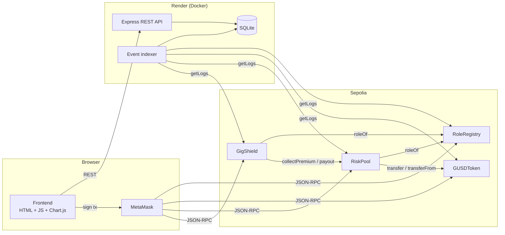

# 🛡️ GigShield — On-chain Micro-insurance for Gig Workers

**SC6113 Group Project** · Decentralized insurance claims processing (Project idea #4)

GigShield lets gig / platform workers (food-delivery riders, ride-hailing drivers, couriers) buy **small, short-term insurance policies** (e.g. 10 gUSD for 30 days of accident cover) and file claims that are decided **transparently on-chain** by an independent Auditor. Premiums and payouts flow through a smart-contract risk pool, so every policy, decision and payout is publicly auditable, and payouts are paid automatically the moment a claim is approved.

> **Real-world problem (summary):** Platform workers are usually classified as self-employed and often have no employer-provided injury cover. Retail insurance is priced and packaged for full-time employees: annual premiums, paperwork-heavy claims and weeks-long settlement with little visibility. Singapore's *Platform Workers Act 2024* (in force from 1 Jan 2025) now requires work-injury compensation for platform workers, which shows that the gap is recognised. Workers in many other markets remain uncovered. GigShield shows how micro-premiums, transparent claim rules and instant, tamper-evident settlement can close the gap. (Evidence, stakeholder analysis and impact evaluation go in the technical report.)

---

## 1. Requirement checklist

| Requirement | Where it is implemented |
|---|---|
| ≥ 3 user roles (role-based auth) | `RoleRegistry`: **Admin**, **Auditor**, **Customer**. Wallet = identity, role read on-chain; the UI shows only the tabs for that role. The backend admin endpoint verifies a wallet **signature** against the on-chain role. |
| MetaMask integration & tx signing | `frontend/app.js` uses `ethers.BrowserProvider(window.ethereum)`. Every write is signed in MetaMask. |
| ≥ 3 interacting contracts | **4 contracts** in one file: `GigShield` → `RiskPool` → `GUSDToken`, all of them → `RoleRegistry` (see diagram) |
| ≥ 10 transaction types | **18** (table below) |
| Backend REST API | `backend/server.js` (Express 5) — 9 endpoints |
| Persistent storage | SQLite (`node:sqlite`) — tables `events`, `transactions`, `evidence`, `meta` |
| Exception handling | Solidity custom errors → decoded into friendly UI messages; pre-flight `estimateGas` catches reverts *before* MetaMask opens; API validation + central JSON error handler; indexer retry |
| Dashboard: tx history, event logs, charts | Dashboard tab (8 KPIs + 4 Chart.js charts), Activity tab (my transactions + filterable event log) — responsive |
| Gas estimation & optimisation | Gas-confirmation dialog before every tx (estimate, gwei, max fee). Backend stores estimate vs. actual. [`docs/GAS_REPORT.md`](docs/GAS_REPORT.md) |
| Smart contract testing | 22 Hardhat tests, **100 % line coverage** (`npm test`, `npm run coverage`) |
| Public cloud deployment | `Dockerfile` + `render.yaml` (Render), contracts on Sepolia |

## 2. Architecture



**Contract interactions**

| Caller → Callee | Purpose |
|---|---|
| `GigShield` constructor → `new RoleRegistry / GUSDToken / RiskPool` | one-click deployment and wiring |
| `GigShield` → `RoleRegistry.roleOf` | role checks for products, policies, claims |
| `GigShield` → `RiskPool.collectPremium` → `GUSDToken.transferFrom` | premium moves from customer to pool |
| `GigShield` → `RiskPool.payout` → `GUSDToken.transfer` | claim payout / cancellation refund |
| `RiskPool` → `GigShield.pendingClaimsTotal` | admin cannot withdraw capital reserved for pending claims |
| `RiskPool` → `RoleRegistry.roleOf` | only Admin can deposit / withdraw capital |

**Claim evidence integrity:** the customer's incident description is stored off-chain in the backend DB, and only `keccak256(text)` goes on-chain in `fileClaim`. The Auditor UI recomputes the hash and shows **"✓ Evidence matches on-chain hash"**, so any edit to the database would be detected.

## 3. Transaction types (18)

| # | Role | Contract.function | Description |
|---|---|---|---|
| 1 | Anyone | `RoleRegistry.registerAsCustomer` | Self-onboard as a Customer |
| 2 | Admin | `RoleRegistry.grantRole` | Assign Admin / Auditor / Customer |
| 3 | Admin | `RoleRegistry.revokeRole` | Remove a role (e.g. block fraud). The last Admin is protected |
| 4 | Anyone | `GUSDToken.faucet` | Get 1,000 test gUSD (10-min cooldown) |
| 5 | Anyone | `GUSDToken.approve` | Allow the RiskPool to pull premium / capital (exact amount) |
| 6 | Anyone | `GUSDToken.transfer` | Transfer gUSD |
| 7 | Admin | `RiskPool.deposit` | Add underwriting capital |
| 8 | Admin | `RiskPool.withdraw` | Withdraw *free* capital only |
| 9 | Admin | `GigShield.createProduct` | New product (premium, coverage, duration) |
| 10 | Admin | `GigShield.setProductActive` | Put a product on / off sale |
| 11 | Admin | `GigShield.setPaused` | Emergency pause / unpause |
| 12 | Customer | `GigShield.buyPolicy` | Pay the premium → policy is created on-chain |
| 13 | Customer | `GigShield.cancelPolicy` | Cancel; pro-rata refund if no claim was paid |
| 14 | Customer | `GigShield.fileClaim` | Claim ≤ remaining coverage + evidence hash |
| 15 | Customer | `GigShield.withdrawClaim` | Withdraw a pending claim |
| 16 | Auditor | `GigShield.approveClaim` | Approve → **automatic payout** from pool |
| 17 | Auditor | `GigShield.rejectClaim` | Reject with a mandatory reason |
| 18 | Admin | *(constructor)* `GigShield` | Deploys & wires all 4 contracts |

## 4. Quick start

### Option A — Remix + Sepolia (the demo setup)

1. **Deploy the contracts in Remix**
   - Open <https://remix.ethereum.org>, create `GigShield.sol`, paste [`contracts/GigShield.sol`](contracts/GigShield.sol).
   - *Solidity Compiler*: version ≥ 0.8.20 → **Compile** (the default settings work; enabling the optimizer (200 runs) lowers gas).
   - *Deploy & Run*: Environment = **Injected Provider – MetaMask** (Sepolia), Contract = **GigShield** → **Deploy**. No constructor arguments. ⚠️ Select GigShield explicitly: Remix often pre-selects another contract from the file (e.g. GUSDToken).
   - Copy the deployed GigShield address. The deploying wallet is the first **Admin**.
2. **Run the web app** (Node ≥ 22.13)
   ```bash
   npm install
   npm start            # http://localhost:4000 (backend reads Sepolia via a public RPC)
   ```
3. Open <http://localhost:4000> → **Connect MetaMask** (Admin wallet) → **Setup** tab → paste the address → *Use this contract* → *Sign & register with backend*.
4. Follow the demo script in [`docs/DEMO_GUIDE_zh.md`](docs/DEMO_GUIDE_zh.md).

You need three MetaMask accounts with a little Sepolia ETH (Admin, Auditor, Customer). gUSD comes from the in-app faucet.

### Option B — Fully local (Hardhat node, no faucet ETH needed)

```bash
npm install
npm run chain          # terminal 1: local chain at :8545 (chainId 31337)
npm run deploy:local   # terminal 2
npm run dev:local      # terminal 2: backend + frontend at :4000 using the local chain
npm run seed:local     # optional: demo data (3 products, 4 policies, 3 claims)
```
Add network `http://127.0.0.1:8545` / chainId `31337` to MetaMask and import Hardhat accounts #0 (Admin), #1 (Auditor) and #2 (Customer). Their private keys are printed by `npm run chain`. Then register the contract via the Setup tab, or start with `CONTRACT_ADDRESS=0x… npm run dev:local`.

### Cloud deployment (Render)

1. Push this folder to GitHub.
2. Render → **New → Blueprint** → pick the repo (uses `render.yaml` + `Dockerfile`).
3. Set the env var `CONTRACT_ADDRESS` to your Sepolia GigShield address, or register it later from the Setup tab.
4. The public URL serves both the dApp and the API.

| Env var | Default | Meaning |
|---|---|---|
| `PORT` | 4000 | HTTP port |
| `RPC_URL` | `https://ethereum-sepolia-rpc.publicnode.com` | chain the indexer reads |
| `CONTRACT_ADDRESS` | – | GigShield address (else the one registered via the UI) |
| `DATA_DIR` | `./data` | SQLite location |
| `POLL_MS` / `LOG_CHUNK` | 8000 / 2000 | indexer poll interval / block range per `getLogs` |

> On Render's free plan the disk is ephemeral. After a restart the indexer rebuilds all events from the chain, but off-chain evidence texts and tx gas records are lost. Attach a Render Disk at `/app/data` for full persistence.

## 5. REST API

| Method | Path | Description |
|---|---|---|
| GET | `/api/health` | liveness + indexer status |
| GET | `/api/config` | active contract addresses, chain id, indexer status |
| POST | `/api/config` | register contract `{address, timestamp, signature}`. The signer must be an on-chain **Admin** |
| GET | `/api/stats` | KPIs, claim status counts, daily premiums/payouts, gas per action, event counts |
| GET | `/api/events?name=&source=&actor=&limit=&offset=` | indexed event log (paginated) |
| GET | `/api/transactions?from=` | dApp transaction history with gas estimate vs. used |
| POST | `/api/transactions` | record a tx. The backend re-reads the receipt from the chain to verify sender, gas and status |
| POST | `/api/evidence` | store claim evidence text, returns its `keccak256` |
| GET | `/api/evidence/:hash` | fetch evidence + integrity check |

All errors return `{ "error": "message" }` with proper status codes (400/403/404/409/500).

## 6. Security design

- **Role-based access control** with a single role per address (separation of duties: an Auditor can never be a claimant). The last Admin cannot be removed.
- **Checks-Effects-Interactions** and **re-entrancy guards** on every function that moves funds (`buyPolicy`, `cancelPolicy`, `approveClaim`, `deposit`, `withdraw`, `payout`).
- **Solvency protection:** `pendingClaimsTotal` is reserved, so the Admin cannot withdraw it. A payout to an insolvent pool reverts atomically.
- **Business-rule validation:** claim ≤ remaining coverage, one open claim per policy, policy must be active and unexpired, a rejection needs a reason, `SelfAssessment` guard.
- **Emergency stop** (`setPaused`) blocks new policies, claims and approvals.
- **Exact-amount approvals** in the UI (no unlimited allowances). Solidity ≥ 0.8 checked arithmetic.
- **Off-chain data integrity** via on-chain hashes. The backend admin action is authenticated by an EIP-191 signature with a 5-minute replay window.

## 7. Testing & gas

```bash
npm test          # 22 tests: roles, token, pool, products, policies, claims, edge cases
npm run coverage  # solidity-coverage: 100% lines / 99% statements
npm run gas       # regenerates docs/GAS_REPORT.md (estimate vs. actual for every tx type)
```

## 8. Project structure

```
gigshield/
├── contracts/GigShield.sol     # ALL 4 contracts in one file (deploy "GigShield" in Remix)
├── backend/
│   ├── server.js               # Express REST API + static hosting
│   ├── indexer.js              # polls chain events → SQLite
│   └── db.js                   # SQLite schema
├── frontend/
│   ├── index.html · styles.css · app.js   # no build step
│   └── abi.js                  # human-readable ABIs (shared with backend)
├── test/                       # Hardhat tests + gas report
├── scripts/                    # local deploy + demo seed
├── docs/                       # demo guide, gas report
├── Dockerfile · render.yaml    # cloud deployment
└── hardhat.config.cjs
```
